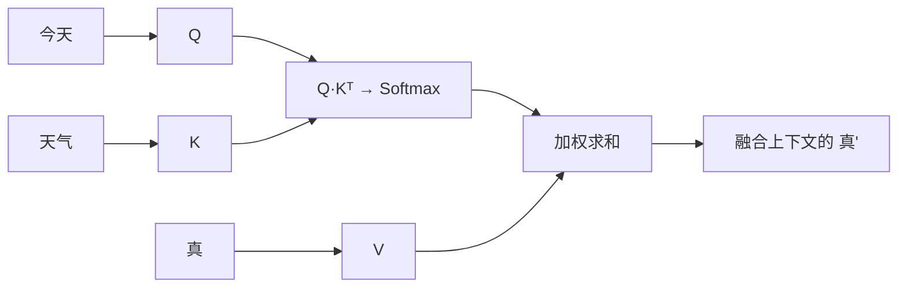
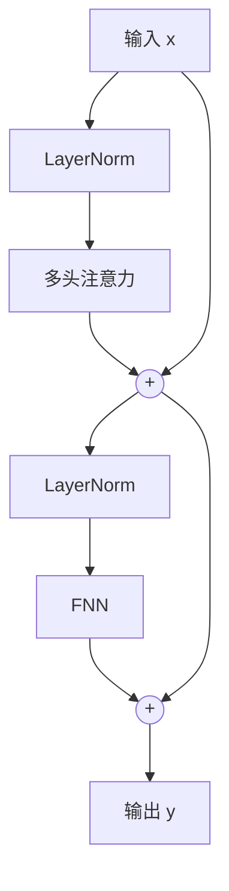

> [!NOTE] Agent 整理
>
> 这篇是 Agent 根据 [[LLM 总览]] 的架构部分整理的对照稿，不是我的个人笔记；保留下来作为参考资料。

## 架构演进：每加一个部件，解决了什么问题

前面已经把问题定义、概率分解和最简单的架构走了一遍。下面换个视角：只看架构，不看细节。每一版只比上一版多一个部件，每加一次都问三个问题：

1. 原来的设计能做什么？
2. 它卡在哪里？
3. 新部件解决了什么，又留下了什么新问题？

> [!NOTE]
>
> 这一节是主线，不展开公式。细节仍然在后面各节；专题笔记写好后，这里只保留图和链接。

### 第 1 步：Embedding —— 让词变成可计算的向量

- **原来的设计**：给每个词一个编号，或者用 One-Hot 编码。
- **卡在哪里**：编号天然有大小和距离；One-Hot 的维度等于词表大小，而且任意两个词距离都一样，学不到「猫」和「狗」比「猫」和「石头」更近。
- **新设计**：把每个 Token 表示成一个低维稠密向量，向量从数据里学出来；Embedding 矩阵按 Token ID 取一行。

原理见 [[词嵌入]]。

### 第 2 步：FNN —— 让网络拟合非线性关系

- **原来的设计**：只做线性变换。
- **卡在哪里**：线性层叠线性层还是线性，表达不了「天气」和「好」之间那种非线性的搭配。
- **新设计**：先升维，过一个非线性激活函数，再降维；这样多层网络才不会坍缩成一个矩阵。
- **留下的问题**：FNN 是逐位置计算的，第 1 个 Token 永远不知道第 3 个 Token 是什么。

原理见 [[前馈网络]]。

### 第 3 步：Attention —— 让 Token 读取上下文

- **原来的设计**：每个 Token 单独过 FNN，输出只和当前输入有关。
- **卡在哪里**：同一个「真」，在「今天天气真好」和「今天天气真差」里应该有不同的表示，但网络看不到上下文。
- **新设计**：用当前 Token 的 Q 去匹配所有 Token 的 K，得到权重，再对所有 V 加权求和（严格来说，权重还要经过 Softmax 归一化，见 [[Softmax 与采样]]）。
- **留下的问题**：Attention 只看内容不看顺序；位置信息需要另外注入。

原理见 [[注意力机制]]；位置问题见 [[位置编码]]。

### 第 4 步：残差 + Norm —— 让 Transformer 能堆深

- **原来的设计**：Attention 接 FNN，直接往深了堆。
- **卡在哪里**：梯度在几十层里传不稳，每一层的输入分布也一直在变，训练容易发散。
- **新设计**：把每个子层包成「归一化 → 子层 → 残差相加」。残差给梯度一条短路，Norm 把数值拉回稳定区间。
- **结果**：同一个 Block 可以重复 N 次；Embedding → N × Block → 线性投影 → Softmax，就是 GPT 这类模型的主干。

原理见 [[Transformer 块]]。

### 四步放在一起

| 步骤 | 新增部件 | 解决了什么 | 又留下了什么 |
| --- | --- | --- | --- |
| 1 | Embedding | 文字变成可计算的向量 | 只有词义，没有上下文 |
| 2 | FNN | 非线性拟合 | 每个位置独立，Token 之间不交流 |
| 3 | Attention | Token 直接读取上下文 | 不知道顺序；单层表达力有限 |
| 4 | 残差 + Norm | 可以稳定地堆深 | 计算量、长上下文、显存 |

回头看，语言模型要做的事一直没变：给定前文，输出下一个 Token 的概率分布。变的是**怎样在算得起的前提下，让每个位置看见足够多的上下文**。

回到总览：[[LLM 总览]]
